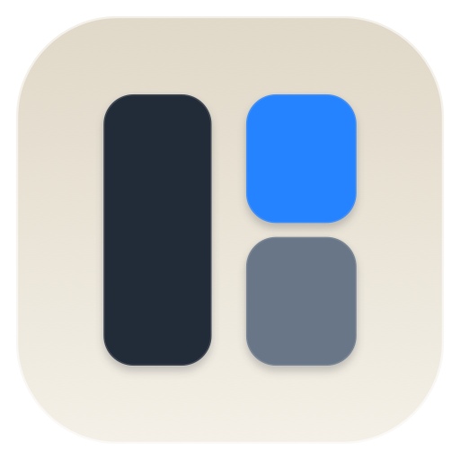
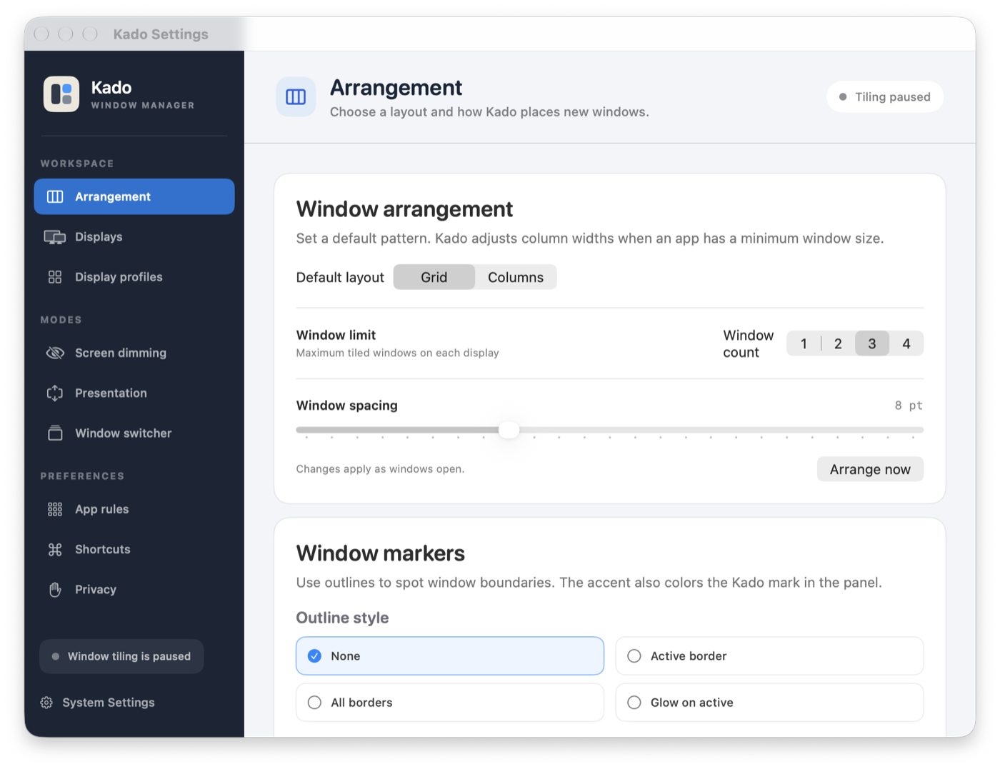
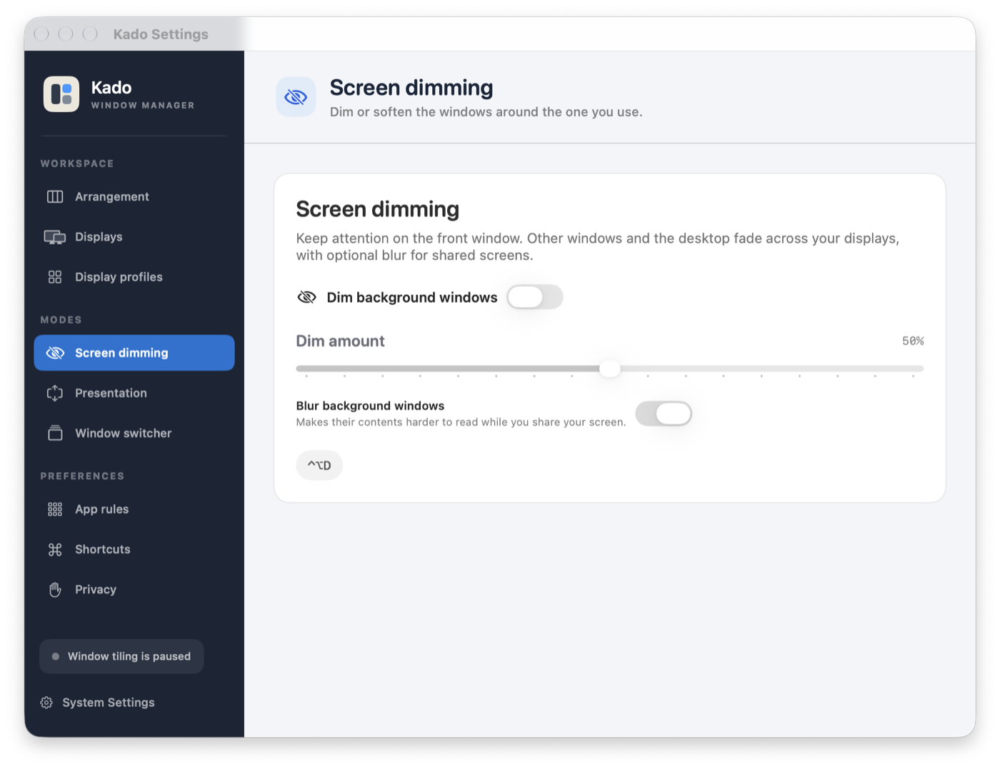

<p align="center">
  
</p>

<h1 align="center">Kado</h1>

<p align="center">A calmer way to arrange your Mac’s windows.</p>

<p align="center">
  <a href="https://github.com/MrBalourd/kado-window-manager/releases/latest"><strong>Download Kado for macOS</strong></a>
  · <a href="#install">Install guide</a>
  · <a href="#features">Features</a>
</p>

<p align="center">macOS 14+ · Apple silicon and Intel · Native Swift app</p>



Kado arranges windows as you work. Choose a layout, set how many windows fit on each display, and let Kado make room as windows open and close.

## Install

### Download the app

1. Open [the latest Kado release](https://github.com/MrBalourd/kado-window-manager/releases/latest).
2. Download `Kado-0.1.0-macos-universal.zip` and open it.
3. Move `Kado.app` to **Applications**.
4. Open Kado. On the first launch, macOS may block an app downloaded from GitHub. Control-click `Kado.app`, choose **Open**, then confirm.
5. Allow window control in **System Settings → Privacy & Security → Accessibility**. Enable **Kado**. If it is not listed, use the add button and choose `Kado.app` in Applications.
6. Open Kado from the menu bar and switch on **Automatic tiling**.

The release is a universal build for Apple silicon and Intel Macs. It is ad-hoc signed and not notarized, so macOS may ask you to confirm the first launch. Kado needs Accessibility access to move and resize windows.

### Build it yourself

Requirements: macOS 14 or later and Xcode Command Line Tools with Swift 6. Install the tools if needed, then run:

```sh
xcode-select --install
git clone https://github.com/MrBalourd/kado-window-manager.git
cd kado-window-manager
./build-app.sh
```

This creates `Kado.app` for the Mac you are using. The script uses ad-hoc signing by default and does not need a developer certificate.

To create a universal ZIP for a GitHub Release, run:

```sh
./package-release.sh
```

The package appears in `release/` as `Kado-<version>-macos-universal.zip`.

## Features

- **Automatic tiling:** new windows get a place; when one closes, the others use the space.
- **Grid or Columns:** choose a layout and tile one to four windows on each display.
- **Adaptive columns:** Kado respects the minimum widths apps accept and shares remaining space between windows. If a layout still cannot fit, it switches to Grid to keep windows visible.
- **Window swapping:** drag to swap, or use keyboard shortcuts to move the focused window between tiles.
- **Overflow stacks:** when more windows are open than tiles, extra windows stack in the active tile.
- **Per-display layouts:** set a different layout and window limit for each screen.
- **Presentation:** enlarge the focused window across one display and cover the unused area.
- **Screen dimming:** fade other windows and the desktop around the one you are using, with optional blur.
- **Window switcher:** open a keyboard-driven view to choose another window.
- **Personal controls:** customize borders, accent color, hover focus, app rules, and shortcuts.



## Keyboard shortcuts

Shortcuts can be enabled or disabled in **Kado settings → Shortcuts**.

| Shortcut | Action |
| --- | --- |
| `⌃⌥⌘1`–`⌃⌥⌘4` | Arrange up to four windows |
| `⌃⌥←` `⌃⌥→` `⌃⌥↑` `⌃⌥↓` | Swap the focused window |
| `⌥Tab` / `⇧⌥Tab` | Open or navigate the window switcher |
| `⌃⌥P` | Toggle Presentation |
| `⌃⌥D` | Toggle Screen dimming |

`⌃` means Control, `⌥` Option, `⌘` Command, and `⇧` Shift.

## Privacy

Kado uses macOS Accessibility to read window geometry and move windows. It does not read window contents or typed characters, and it does not send usage analytics. Preferences stay on your Mac.

## Troubleshooting

- **Windows do not move:** check that Kado is enabled under **System Settings → Privacy & Security → Accessibility**, then quit and reopen Kado.
- **A window remains larger than its tile:** some apps enforce minimum sizes. Kado redistributes column width and uses Grid if the requested layout still cannot fit.
- **A shortcut does nothing:** enable shortcuts in **Kado settings → Shortcuts** and check whether another app uses the same key combination.
- **macOS blocks the first launch:** Control-click `Kado.app`, choose **Open**, and confirm the prompt.

## Contributing

Report bugs and suggest improvements in [GitHub Issues](https://github.com/MrBalourd/kado-window-manager/issues). Include your macOS version and clear steps to reproduce the issue. Avoid attaching screenshots that expose private window contents.

## License

No license has been added yet.
